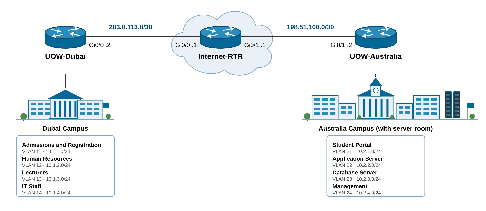

# Cryptographic Design and Analysis of Secure Site-to-Site Communication Using IKEv2 and IPsec

MACS902 Modern Cryptography – Assessment 2, Applied Cryptography Project
University of Wollongong in Dubai · Group GID_09 · Lecturer: Dr Manoj Kumar
Members: Suraj Sekar, Afreen Nissar, Saniya Salim

## Overview

Two university campuses, Dubai and Australia, communicate across the internet. Each campus gateway router protects the traffic between the campuses with IKEv2 and IPsec. Authentication between the gateways starts with a pre-shared key and is then moved to certificates issued by an offline certificate authority (CA) that the group built in Python on the OpenSSL-backed `cryptography` library.

## Contents

| File or folder | Description |
| --- | --- |
| `ikev2_gateway_ca.py` | Offline certificate authority built in Python on the `cryptography` library (OpenSSL backend). Issues ECDSA P-384 certificates to the two gateways. |
| `topology.png` | Lab topology |
| `Configs/Lab1_Cleartext/` | Base network with no encryption: Internet-RTR (with temporary routes), both campus routers, both switches and both PCs |
| `Configs/Lab2_PSK/` | IKEv2/IPsec tunnel with pre-shared-key authentication, and removal of the temporary routes on Internet-RTR |
| `Configs/Lab3_Certificates/` | Move from PSK to ECDSA certificates: `CA.txt` (how to use the CA program) and the steps for both campus routers |
| `Captures/` | Wireshark captures from each lab (see Captures below) |

## Topology and addressing



**Addressing rules**

- Internet links: Internet-RTR is `.1`, the campus router is `.2`, and both ends of a link use the same interface number.
- Campus subnets: `10.<site>.<department>.0/24`, where site 1 is Dubai and site 2 is Australia.
- VLAN IDs: site digit followed by department digit (for example, 10.2.3.0/24 is VLAN 23).
- Gateway: `.254` on every campus subnet.

| Device | Interface | Address | Purpose |
| --- | --- | --- | --- |
| UOW-Dubai | Gi0/0 | 203.0.113.2/30 | Link to the internet |
| UOW-Dubai | Gi0/3.11 | 10.1.1.254/24 | VLAN 11 – Admissions and Registration |
| UOW-Dubai | Gi0/3.12 | 10.1.2.254/24 | VLAN 12 – Human Resources |
| UOW-Dubai | Gi0/3.13 | 10.1.3.254/24 | VLAN 13 – Lecturers |
| UOW-Dubai | Gi0/3.14 | 10.1.4.254/24 | VLAN 14 – IT Staff |
| UOW-Dubai | Tunnel0 | 172.16.0.1/30 | IPsec tunnel to Australia |
| UOW-Australia | Gi0/1 | 198.51.100.2/30 | Link to the internet |
| UOW-Australia | Gi0/3.21 | 10.2.1.254/24 | VLAN 21 – Student Portal |
| UOW-Australia | Gi0/3.22 | 10.2.2.254/24 | VLAN 22 – Application Server |
| UOW-Australia | Gi0/3.23 | 10.2.3.254/24 | VLAN 23 – Database Server |
| UOW-Australia | Gi0/3.24 | 10.2.4.254/24 | VLAN 24 – Management |
| UOW-Australia | Tunnel0 | 172.16.0.2/30 | IPsec tunnel to Dubai |

Traffic between the campuses (10.1.0.0/16 and 10.2.0.0/16) is routed only through Tunnel0, so it is always encrypted.

## Cryptography used

| Function | Algorithm |
| --- | --- |
| Key exchange | ECDH over P-384 (DH group 20), with perfect forward secrecy |
| Key derivation | HMAC-SHA-384 |
| Encryption and integrity | AES-256-GCM |
| Authentication | Pre-shared key (baseline), then ECDSA P-384 certificates |
| Certificate signatures | ECDSA with SHA-384 |

## Router configurations

### Phase 1 – IKE SA (protects the negotiation between the gateways)

| Configuration block | What it does |
| --- | --- |
| `crypto ikev2 proposal PROP-AES256GCM` | The algorithms offered for Phase 1: AES-256-GCM encryption, HMAC-SHA-384 PRF, DH group 20. Only this one set is configured, so no weaker set can be negotiated. |
| `crypto ikev2 policy POL-AES256GCM` | Applies the proposal. |
| `crypto ikev2 keyring` (Lab 2 only) | Holds the pre-shared key for the peer gateway's address. |
| `crypto ikev2 profile` | Defines who the peer is and how each side proves its identity: `pre-share` in Lab 2, `ecdsa-sig` with the trustpoint in Lab 3. |

### Phase 2 – IPsec SA (protects the campus traffic)

| Configuration block | What it does |
| --- | --- |
| `crypto ipsec transform-set TS-AES256GCM esp-gcm 256` | ESP with AES-256-GCM for the campus traffic, in tunnel mode. |
| `crypto ipsec profile` | Combines the transform set, `set pfs group20` (a fresh DH exchange at every rekey) and the IKEv2 profile. |
| `interface Tunnel0` | The tunnel between the gateways (`tunnel mode ipsec ipv4`), protected by the IPsec profile. |
| `ip route 10.x.0.0 255.255.0.0 Tunnel0` | Sends traffic for the other campus into the tunnel. |

### Lab 2 (PSK) vs Lab 3 (certificates)

| | Lab 2 – pre-shared key | Lab 3 – certificates |
| --- | --- | --- |
| Identity proof | One shared secret on both gateways | Each gateway's own private key and certificate |
| Extra blocks | `crypto ikev2 keyring` | `crypto pki trustpoint UOWD-ROOT-CA`, `crypto pki certificate map` |
| Profile authentication | `pre-share` | `ecdsa-sig` |
| Peer identity | Peer's IP address | Certificate subject, checked by the certificate map |

## Certificate authority

The CA (`ikev2_gateway_ca.py`) runs on a separate machine with no network connection to the routers. Requests and certificates are carried between the CA and the routers by hand.

| Operation | What it does | Library functions used |
| --- | --- | --- |
| `init` | Creates the CA key pair (ECDSA P-384) and the self-signed root certificate, signed with SHA-384. Stores the private key encrypted under a passphrase and prints the root certificate's fingerprint. | `ec.generate_private_key`, `CertificateBuilder().sign`, `random_serial_number`, `BestAvailableEncryption` |
| `sign` | Reads a router's certificate signing request (CSR), checks that it is signed by the router's own private key and that the key is ECDSA P-384, then issues the router's certificate signed with SHA-384. | `load_pem_x509_csr`, `is_signature_valid`, `CertificateBuilder().sign` |

Requirements: Python 3, the `cryptography` library, and the OpenSSL command-line tool for verification.

```
python3 ikev2_gateway_ca.py init                  # create the CA
python3 ikev2_gateway_ca.py sign <gateway>.csr    # issue a router certificate
openssl verify -CAfile ca_cert.pem <gateway>.crt  # verify it independently
```

## How to reproduce the lab

Each file lists its steps in order and says which file it builds on. Steps are marked `[EXEC]` (router prompt), `[CONFIG]` (configuration mode) or `[MAC]` (the CA machine).

1. **Lab 1 – no encryption.** Apply the files in `Configs/Lab1_Cleartext/`. Dubai-PC (10.1.1.1) can ping Australia-PC (10.2.1.1), and the traffic is readable in Wireshark on the internet links.
2. **Lab 2 – pre-shared key.** Remove the temporary routes on Internet-RTR, then apply `Configs/Lab2_PSK/` on both campus routers. The same ping now crosses the internet only as ESP.
3. **Lab 3 – certificates.** Create the CA with `CA.txt`, then follow the Lab 3 file on each campus router: remove the PSK, enrol the router with the CA, and switch the IKEv2 profile to ECDSA. The tunnel comes up authenticated by certificates.

## Captures

| File | Shows |
| --- | --- |
| `Captures/Unencrypted-wireshark-capture.pcapng` | Lab 1: ICMP between the campuses in clear text |
| `Captures/DH_Group_MisMatch.pcapng` | Lab 2: DH group 20 on one gateway and group 14 on the other; IKE_SA_INIT is refused with NO_PROPOSAL_CHOSEN and no tunnel forms |
| `Captures/PSK - Lab Results.pcapng` | Lab 2: IKE_SA_INIT and IKE_AUTH with the pre-shared key, then ESP traffic |
| `Captures/Cert - Lab Results.pcapng` | Lab 3: IKE_SA_INIT and IKE_AUTH with ECDSA certificates, then ESP traffic |

## Notes

- The CA private key (`ca_key.pem`) is not included in this repository.
- The pre-shared key in the configurations is shown as the placeholder `<PRE-SHARED-KEY>`.
- Router clocks must be set to the current date before importing certificates, so the certificates are within their validity period.
